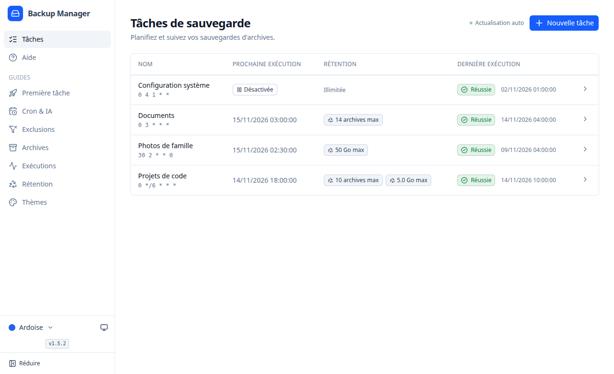
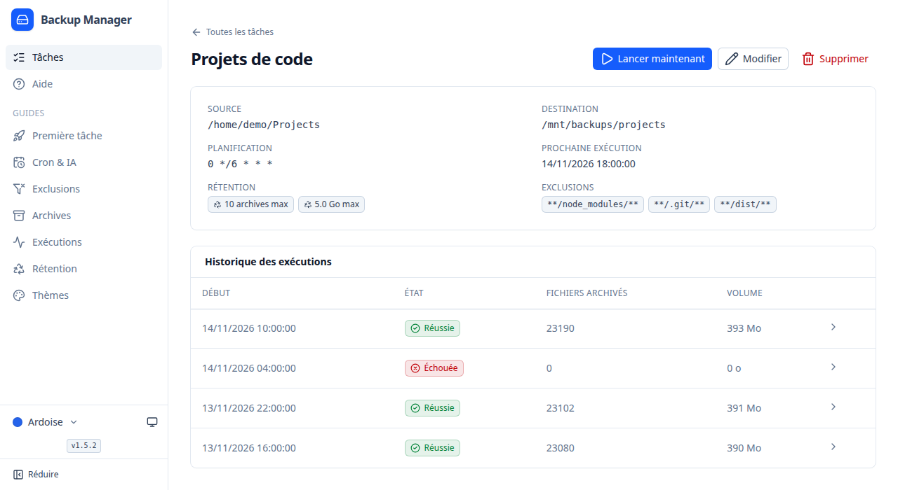

# Backup Manager

Planifiez et suivez des sauvegardes de dossiers depuis une interface web simple : chaque tâche archive un dossier source en `.tar.gz` horodaté, selon une planification cron, avec historique, liste des fichiers archivés et rétention automatique des anciennes archives.



> [!CAUTION]
> **Application à usage individuel et personnel, à faire tourner sur sa propre machine.**
> Backup Manager n'a **aucune authentification** et donne accès au système de fichiers du serveur (sélecteur de dossier, lecture des sources, écriture des destinations). Son modèle de sécurité ne permet pas de la partager ni de l'exposer : ne la publiez pas sur Internet, ni sur un réseau partagé, ni derrière un simple reverse proxy. Avec Docker elle n'est publiée que sur `127.0.0.1` ; sans Docker, définissez `HOST=127.0.0.1`. Elle est fournie telle quelle, sans garantie : vérifiez vos sauvegardes et ne l'utilisez pas comme unique protection de données critiques.

## Sommaire

- [Fonctionnalités](#fonctionnalités)
- [Aperçu](#aperçu)
- [Démarrage rapide](#démarrage-rapide)
- [Configuration du fichier `.env`](#configuration-du-fichier-env)
- [Docker](#docker) (dont l'[image GHCR](#image-prête-à-lemploi-ghcr))
- [Utilisation](#utilisation)
- [Développement](#développement)
- [Limites connues](#limites-connues)

## Fonctionnalités

- **Tâches de sauvegarde** : dossier source, destination, planification cron, exclusions par motifs glob, activation/désactivation, lancement manuel.
- **Archives `.tar.gz` horodatées** (`<nom>-AAAAMMJJ-HHMMSS.tar.gz`), écrites en `.partial` puis renommées : une exécution interrompue ne laisse jamais d'archive tronquée sous le nom final.
- **Rétention par tâche** : garder au plus N archives et/ou un volume total maximum (M ou G). La purge s'applique après chaque sauvegarde réussie et ne touche que les archives de la tâche.
- **Historique** des exécutions, liste (paginée et filtrable) des fichiers de chaque archive, actualisation automatique de l'accueil.
- **Suggestion de cron par IA** (optionnelle) : décrivez une planification en français ou en anglais, l'application propose l'expression cron.
- **Guides d'aide intégrés** (`/help`), thèmes de couleur, mode clair/sombre/système, navigation repliable, interface responsive.

## Aperçu



*Captures réalisées avec des données de démonstration.*

## Démarrage rapide

### Avec Docker (recommandé)

```bash
git clone https://github.com/montblanc13/backup-manager.git
cd backup-manager
cp .env.example .env   # facultatif, voir la section configuration
docker compose up --build
```

Ouvrez ensuite **http://127.0.0.1:9090**. Détails, Docker rootless et montage de dossiers : [Docker](#docker).

### Sans Docker

Prérequis : **Node.js 26** (module natif `node:sqlite`) et npm.

```bash
git clone https://github.com/montblanc13/backup-manager.git
cd backup-manager
npm install
cp .env.example .env   # facultatif, voir la section configuration
npm run dev
```

Ouvrez **http://localhost:3000**. Les migrations de la base sont appliquées automatiquement au premier accès. Pour la production : `npm run build` puis `HOST=127.0.0.1 node .output/server/index.mjs` (sans `HOST`, le serveur de production écoute sur **toutes** les interfaces réseau).

> Les planifications ne se déclenchent que **pendant que l'application tourne** : si elle est arrêtée à l'heure prévue, la sauvegarde n'est pas rattrapée.

## Configuration du fichier `.env`

Toute la configuration passe par des variables d'environnement. Copiez le modèle puis adaptez-le :

```bash
cp .env.example .env
```

- Le fichier `.env` est **ignoré par Git** : ne le commitez jamais (il peut contenir une clé d'API).
- Nuxt lit les variables préfixées `NUXT_` et les associe à la configuration de l'application : `NUXT_<CLE_EN_SNAKE_CASE>` surcharge la clé correspondante (par exemple `dataDir` → `NUXT_DATA_DIR`).
- Toutes les variables sont facultatives : sans fichier `.env`, les valeurs par défaut du tableau ci-dessous s'appliquent.
- Après modification, **redémarrez** l'application (`npm run dev`, ou `docker compose up -d` pour recréer le conteneur).

### Variables de l'application

| Variable | Rôle | Défaut | Exemple |
| --- | --- | --- | --- |
| `NUXT_DATA_DIR` | Racine du stockage : base SQLite dans `db/`, fichiers de l'application dans `data/` (créés au besoin). | `<HOME>/.config/backup-manager` (Linux, macOS, Windows ; Docker : le même dossier sous le HOME de l'hôte) | `/home/moi/.config/backup-manager` |
| `NUXT_MIGRATIONS_FOLDER` | Dossier des migrations SQL (Drizzle), appliquées automatiquement au démarrage. À ne changer que pour un déploiement particulier. | `./server/database/migrations` | `/app/migrations` |
| `NUXT_ANTHROPIC_API_KEY` | Clé d'API Anthropic pour la suggestion de cron par IA. **Optionnelle**, voir l'encadré ci-dessous. | vide (fonction désactivée) | `sk-ant-...` |
| `NUXT_ANTHROPIC_MODEL` | Modèle utilisé pour la suggestion de cron. Un modèle léger (par exemple `claude-haiku-5-5`) est moins cher et plus rapide. | `claude-opus-5-5` | `claude-haiku-5-5` |
| `NUXT_BROWSE_ROOT` | Racine du sélecteur de dossier : l'interface ne permet pas de naviguer au-dessus. Les liens symboliques qui sortent de cette racine restent suivis. | `/` | `/home/moi` |

> [!WARNING]
> **La clé d'API Anthropic est optionnelle.** Elle ne sert qu'à **vous aider à écrire vos expressions cron** : quand vous quittez le champ de description d'une tâche, le texte saisi est envoyé à l'API Anthropic (service tiers, facturé à l'usage) qui propose une expression ; rien n'est appliqué sans votre clic sur « Utiliser ».
> **Sans clé, tout le reste fonctionne normalement** : seule la suggestion est désactivée (l'API renvoie 503) et vous saisissez l'expression cron à la main.
> La clé est un **secret** : placez-la uniquement dans `.env`, ne la commitez pas et ne la partagez pas.

### Variables du serveur HTTP

| Variable | Rôle | Défaut | Remarque |
| --- | --- | --- | --- |
| `PORT` | Port d'écoute du serveur. **Avec Docker, c'est le port côté hôte** (le port interne du conteneur reste `3000`). | `3000` (Docker : `9090`) | Une valeur déjà utilisée provoque une erreur au démarrage. |
| `HOST` | Interface d'écoute. **Sans Docker, définissez `HOST=127.0.0.1`** pour n'écouter qu'en local. | `npm run dev` : local ; build de production : **toutes les interfaces** | Dans le conteneur, `0.0.0.0` est forcé, l'exposition est limitée à `127.0.0.1` côté hôte. |

### Variables propres à Docker

| Variable | Rôle | Défaut |
| --- | --- | --- |
| `APP_UID` / `APP_GID` | Utilisateur du conteneur. À mettre à `0` et `0` avec **Docker rootless** (voir plus bas). | `1000` / `1000` |
| `APP_IMAGE` | Image à utiliser au lieu de la construire (voir [GHCR](#image-prête-à-lemploi-ghcr)). | construite localement |

Avec Docker, **le même `.env` fonctionne qu'en développement** : le HOME de l'hôte est monté à l'identique dans le conteneur (voir [Docker](#docker)), donc le stockage (`~/.config/backup-manager`), `NUXT_BROWSE_ROOT` et les chemins des tâches sont valables tels quels. `compose.yaml` ne force que `HOST`, `PORT` (interne `3000`) et `NUXT_MIGRATIONS_FOLDER=/app/migrations`, qui l'emportent sur le `.env`.

### Exemple complet

```bash
# --- Application ---
# NUXT_DATA_DIR=/home/moi/.config/backup-manager   # défaut : <HOME>/.config/backup-manager
# NUXT_MIGRATIONS_FOLDER=./server/database/migrations

# Suggestion de cron par IA (facultatif)
NUXT_ANTHROPIC_API_KEY=sk-ant-votre-cle
NUXT_ANTHROPIC_MODEL=claude-haiku-5-5

# Limiter le sélecteur de dossier à votre répertoire personnel
NUXT_BROWSE_ROOT=/home/moi

# --- Serveur ---
PORT=3000
HOST=127.0.0.1   # n'écouter qu'en local (important sans Docker en production)

# --- Docker uniquement ---
# APP_UID=0     # Docker rootless (voir plus bas)
# APP_GID=0
```

## Docker

```bash
docker compose up --build        # construit l'image et démarre
docker compose up -d --build     # idem, en arrière-plan
docker compose logs -f           # suivre les journaux
```

L'application est publiée sur `127.0.0.1` uniquement (jamais sur le réseau), au port hôte `PORT` (défaut `9090`).

### Image prête à l'emploi (GHCR)

Chaque version (tag `vA.B.C`) est publiée sur le GitHub Container Registry sous le nom d'image **`sla-backup-manager`** :

```text
ghcr.io/montblanc13/sla-backup-manager
```

- **Tags** : `A.B.C` (version exacte, à privilégier), `A.B` et `latest`.
- **Architectures** : `linux/amd64` et `linux/arm64`.
- L'image est construite et analysée (Trivy) par la CI avant publication, avec provenance et SBOM.

Pour l'utiliser avec `compose.yaml` **sans construire l'image** (définissez `APP_IMAGE` dans `.env`, ou en variable d'environnement) :

```bash
echo 'APP_IMAGE=ghcr.io/montblanc13/sla-backup-manager:latest' >> .env
docker compose pull
docker compose up -d --no-build
```

Les autres réglages de cette section (volumes, `PORT`, `APP_UID` / `APP_GID`, rootless) s'appliquent à l'identique. Sans `APP_IMAGE`, `docker compose up --build` construit l'image depuis les sources.

> L'avertissement d'usage personnel en tête de page s'applique aussi à l'image publiée : elle est destinée à tourner en local, pas à être exposée.

### Dossiers accessibles depuis le conteneur

Votre **HOME est monté à l'identique** dans le conteneur : saisissez dans l'application les chemins de l'hôte, tels quels (`/home/moi/Documents`, …). Le stockage de l'application est le même qu'avec `npm run dev` : `~/.config/backup-manager/db/backup-manager.db` (base SQLite) et `~/.config/backup-manager/data/`. Le sélecteur de dossier (`NUXT_BROWSE_ROOT`) a pour défaut votre HOME.

**Windows (Docker Desktop)** : le HOME (`C:/Users/moi`) ne peut pas servir de chemin dans le conteneur Linux. Ajoutez `compose.windows.yaml`, qui monte votre profil sur `/host-home` :

```powershell
docker compose -f compose.yaml -f compose.windows.yaml up --build
```

Pour ne plus avoir à le préciser, ajoutez `COMPOSE_FILE=compose.yaml;compose.windows.yaml` à `.env`. Dans l'application, saisissez alors les chemins sous la forme `/host-home/Documents/...`. Le stockage est le même dossier qu'avec `npm run dev` (`C:/Users/moi/.config/backup-manager`) ; les `NUXT_DATA_DIR` / `NUXT_BROWSE_ROOT` du `.env` sont ignorés dans le conteneur.

Pour un disque ou un dossier **hors du HOME**, décommentez et adaptez un exemple de `compose.yaml` en montant le dossier **au même chemin** que sur l'hôte (`/mnt/sauvegardes:/mnt/sauvegardes`).

> [!WARNING]
> Ne lancez pas `npm run dev` et Docker **en même temps** sur la même base : les deux exécuteraient chaque planification, et les archives seraient produites en double.

### Liens symboliques et disques externes

Seul le HOME est monté par défaut. Un lien symbolique du HOME qui pointe **vers l'extérieur** (disque externe, `/mnt/...`, `/run/media/...`) est **cassé dans le conteneur** tant que sa cible n'y est pas montée : la destination est alors « introuvable » alors qu'elle fonctionne avec `npm run dev`. Pour le vérifier : `ls -l ~/Documents/kDrive`.

Montez la **cible** du lien au même chemin que sur l'hôte, dans un fichier local `compose.override.yaml` (ignoré par Git, chargé automatiquement) :

```bash
cp compose.override.example.yaml compose.override.yaml   # puis adapter le chemin du disque
docker compose up -d
```

Le disque doit être monté sur l'hôte **avant** de démarrer le conteneur. En cas de lien cassé, la sauvegarde échoue avec un message qui nomme le lien et sa cible.

### Droits d'accès

Le conteneur tourne par défaut avec l'utilisateur `node` (uid/gid `1000`). Les dossiers de l'hôte doivent lui être accessibles en écriture (au minimum la base et les destinations) :

```bash
chown -R 1000:1000 /chemin/de/la/destination   # Docker classique ; la base se crée sous `~/.config/backup-manager`
```

> [!IMPORTANT]
> **Docker rootless** (`docker info` affiche `rootless`) : l'uid 1000 du conteneur n'est pas votre utilisateur d'hôte, et l'application échoue avec `unable to open database file`. Ajoutez dans `.env` :
>
> ```bash
> APP_UID=0
> APP_GID=0
> ```
>
> En rootless, le root du conteneur correspond à votre utilisateur d'hôte : il n'a pas de privilège supplémentaire sur la machine.

Sur une distribution avec **SELinux** (Fedora, RHEL…), ajoutez `:z` aux volumes (par exemple `/mnt/sauvegardes:/mnt/sauvegardes:z`).

## Utilisation

1. **Nouvelle tâche** : choisissez un nom, un dossier source et une destination (sélecteur de dossier intégré), puis une planification cron. Décrivez la planification en langage naturel pour obtenir une suggestion (si la clé d'API est configurée).
2. **Exclusions** : un motif glob par ligne (`**/node_modules/**`, `**/*.tmp`…).
3. **Rétention** (facultatif) : nombre maximum d'archives et/ou volume maximum.
4. **Lancer maintenant** pour tester, puis suivez l'exécution dans l'historique et la liste des fichiers archivés.

Restaurer une archive se fait avec `tar` standard :

```bash
tar -tzf documents-20261114-030000.tar.gz                       # lister
tar -xzf documents-20261114-030000.tar.gz -C /chemin/restauration   # tout restaurer
```

Des guides détaillés (cron, exclusions, rétention, archives, thèmes) sont disponibles dans l'application, sous **Aide** (`/help`), et dans [`content/help/`](content/help).

## Développement

Stack : [Nuxt 4](https://nuxt.com), [Nuxt UI](https://ui.nuxt.com), [Nuxt Content](https://content.nuxt.com), SQLite (`node:sqlite`) avec [Drizzle ORM](https://orm.drizzle.team), [croner](https://github.com/Hexagon/croner) pour la planification, [tar](https://github.com/isaacs/node-tar) pour les archives.

```bash
npm run dev          # serveur de développement
npm run build        # build de production
npm run preview      # prévisualisation du build
npm run typecheck    # vérification des types
npm run db:generate  # migration Drizzle après modification de server/database/schema.ts
```

L'architecture en couches (interface → API → services → repositories) et les conventions de code sont décrites dans [CLAUDE.md](CLAUDE.md). Le suivi des versions (`vA.B.C`, source : `package.json`) est dans [CHANGELOG.md](CHANGELOG.md).

## Qualité et sécurité

Les workflows GitHub Actions (`.github/`) s'exécutent à chaque push sur `main`, à chaque pull request et, pour la sécurité, chaque lundi :

| Contrôle | Outil | Bloque quand… |
| --- | --- | --- |
| Types et build | `npm run typecheck`, `npm run build` | une erreur survient |
| Vulnérabilités des dépendances | `npm audit` | une vulnérabilité **moderate ou plus** est détectée (les « low » sans correctif sont listées dans le résumé du job) |
| Dépendances ajoutées par une PR | Dependency Review | la PR introduit une dépendance vulnérable (high ou plus) |
| Analyse statique du code | CodeQL | (alertes dans l'onglet *Security*) |
| Secrets dans le code et l'historique | Gitleaks | un secret est détecté |
| Image Docker | Trivy | une vulnérabilité **critique** avec correctif est détectée |
| Publication de l'image | Build, scan Trivy puis push sur GHCR, sur tag `vA.B.C` | le tag ne correspond pas à `package.json`, ou une vulnérabilité critique corrigeable est détectée |
| Mises à jour | Dependabot | (pull requests hebdomadaires : npm, Docker, GitHub Actions) |

Pour signaler une faille, voir [SECURITY.md](.github/SECURITY.md).

## Limites connues

- **Pas d'authentification**, usage local uniquement (voir l'avertissement en tête de page).
- **Pas de restauration depuis l'interface** : les archives se restaurent avec `tar`.
- **Pas de rattrapage** des sauvegardes manquées quand l'application est arrêtée.
- Deux tâches dont les noms donnent le même identifiant simplifié (par exemple « Docs » et « docs ») et qui partagent une destination se purgent mutuellement : donnez-leur des noms distincts ou des destinations séparées.
